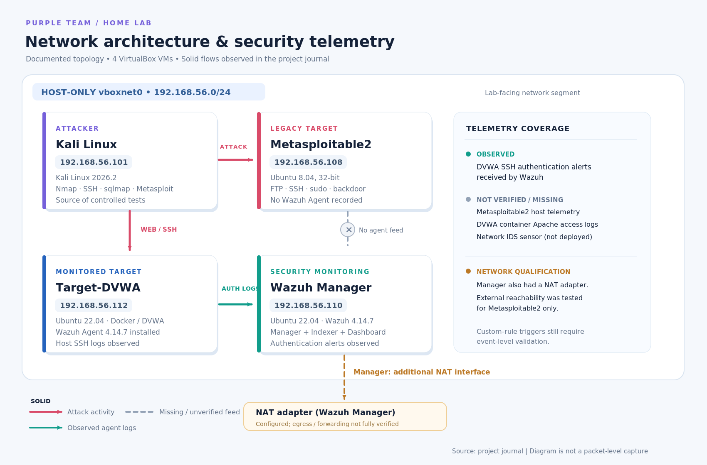

# Purple Team Home Lab | Attack Simulation & Detection Engineering

> A hands-on, four-VM cybersecurity lab combining controlled offensive testing, Wazuh SIEM monitoring, MITRE ATT&CK mapping, and detection-gap analysis.

**Focus:** SOC analysis · Detection engineering · Linux security · Security monitoring · Technical troubleshooting

**Project status:** Attack scenarios and initial SIEM configuration completed. Some alert attribution and custom-rule validation remain open and are documented below.

## Project Overview

This personal project explores a question relevant to security operations: **Can a security monitoring stack actually observe the activity it is expected to detect?**

I deployed deliberately vulnerable systems in a VirtualBox lab, exercised **five controlled attack scenarios** mapped to **four distinct MITRE ATT&CK technique IDs**, and compared attacker-side results with Wazuh alerts. I documented both observed alerts and telemetry gaps, then proposed remediation and verification steps.

**Scope:** Authorised testing against my own intentionally vulnerable lab machines. No production systems or third-party targets were involved.

## Lab Architecture

| Virtual machine | Address (Host-only) | Purpose | Wazuh agent |
|---|---|---|---|
| Kali Linux 2026.2 | `192.168.56.101` | Controlled attack platform | No |
| Metasploitable2 (Ubuntu 8.04, 32-bit) | `192.168.56.108` | Legacy service exploitation target | No — unsupported legacy environment |
| Target-DVWA (Ubuntu 22.04, Docker) | `192.168.56.112` | Web application testing and endpoint monitoring | Yes |
| Wazuh Manager (Ubuntu 22.04) | `192.168.56.110` | Wazuh Manager, Indexer, and Dashboard | N/A — server |

The lab uses a VirtualBox Host-only network (`192.168.56.0/24`). **Metasploitable2 was tested for lack of internet connectivity.** The Wazuh Manager also had a NAT adapter during installation, so it would be inaccurate to describe every VM as fully air-gapped. Endpoint logs from Target-DVWA were forwarded to Wazuh; Metasploitable2 did not have an agent.

[Architecture notes](./docs/architecture-notes.md) · [Editable architecture diagram](./diagrams/lab-architecture.drawio)

## Attack Scenarios & Detection Observations

*"Not observed" means no corresponding Wazuh alert was reported in this lab configuration; it does **not** prove the technique is inherently undetectable.*

| Scenario | ATT&CK mapping | Target / method | Monitoring outcome |
|---|---|---|---|
| Network service discovery | [T1046 — Discovery](https://attack.mitre.org/techniques/T1046/) | Nmap against Metasploitable2 | **Not observed** — no network sensor and no agent on target |
| SSH credential access testing | [T1110 — Credential Access](https://attack.mitre.org/techniques/T1110/) | Hydra attempt and manual SSH validation on Metasploitable2 | **Not observed** — Hydra was blocked by legacy SSH algorithm incompatibility; manual credential validation succeeded |
| SQL injection and database exposure | [T1190 — Initial Access](https://attack.mitre.org/techniques/T1190/) | Manual testing and sqlmap against DVWA | **Not observed** — relevant Apache logs were not ingested from the container |
| Sudo-based privilege escalation | [T1548.003 — Privilege Escalation](https://attack.mitre.org/techniques/T1548/003/) | Excessive sudo permissions on Metasploitable2 | **Alert attribution unverified** — the reported Wazuh `5402` alert requires confirmation because this target had no agent |
| Vulnerable FTP service exploitation | [T1190 — Initial Access](https://attack.mitre.org/techniques/T1190/) | Metasploit vsftpd 2.3.4 backdoor module | **Not observed** — no agent or external sensor on target |

**Additional detection check:** Failed SSH authentication events against **Target-DVWA** generated Wazuh authentication alerts. The notes indicate custom SSH rule `100002` was loaded; whether that rule fired as intended at the configured threshold still needs log-level verification.

[Detailed coverage matrix](./docs/detection-coverage-matrix.md) · [Detection engineering report](./docs/detection-engineering.md)

## Key Findings

1. **Agent coverage matters.** Legacy machines without endpoint telemetry introduced a significant monitoring blind spot. The contrasting SSH authentication tests on Target-DVWA demonstrated the value of an enrolled agent.
2. **Container visibility needs explicit configuration.** A Wazuh agent on the Docker host did not, by itself, collect DVWA's Apache request logs. This prevented meaningful SIEM-side evaluation of the SQL injection traffic.
3. **Network-layer visibility was missing.** Nmap activity was not alerted on in this configuration. Adding a properly positioned network sensor or other suitable network telemetry is a proposed next step, not a completed implementation.
4. **Detection success requires validation.** A rule appearing in the Wazuh ruleset is not equivalent to an alert firing on the intended event or meeting the desired threshold.
5. **Operational troubleshooting was a major learning outcome.** The deployment involved LVM capacity issues, package repair, stale credentials, agent enrolment problems, and legacy SSH compatibility constraints.

### Selected Attack-Side Results

- The `vsftpd 2.3.4` backdoor test reached a root-level session on the deliberately vulnerable Metasploitable2 target; the session type should be checked against the original Metasploit console evidence.
- SQL injection testing exposed five DVWA user records. The notes show **four distinct MD5 hashes across five accounts**, including two accounts sharing the same digest; the four unique digests were reportedly cracked in the lab.
- `sudo -l` on Metasploitable2 showed broad `(ALL) ALL` privileges, and a subsequent shell check returned `root`.
- Wazuh's vulnerability detection flagged **145 CVE findings** associated with the monitored Ubuntu host's kernel. No newer kernel package was available from the configured repositories during the documented test.

## Custom Wazuh Detection Rules

| Rule ID | Intended use | ATT&CK tag in lab notes | Current evidence |
|---|---|---|---|
| `100001` | FTP-related log matching | `T1046` | Authored; trigger and mapping need validation |
| `100002` | Multiple SSH authentication failures from one source IP | `T1110` | Reported loaded in Dashboard; threshold firing not independently verified |
| `100003` | Sudo execution events | `T1548` | Authored; trigger/source attribution needs validation |

The custom rule XML is intended for `wazuh-rules/local_rules.xml`. **Before publishing the XML, verify its behaviour with representative logs and Wazuh `wazuh-logtest`, and review potentially overbroad matches or ATT&CK tags.**

## Documentation

**Weekly progress**

- [Week 01 — Lab Foundation and SIEM Deployment](./docs/weekly/week01-lab-foundation.md)
- [Week 02 — Controlled Attack Simulation](./docs/weekly/week02-attack-simulation.md)
- [Week 03 — Detection Engineering](./docs/weekly/week03-detection-engineering.md)

**Technical reports**

- [Day 08 — SSH Credential Access](./docs/day08-ssh-credential-access.md)
- [Day 09 — SQL Injection](./docs/day09-sql-injection.md)
- [Day 10 — Privilege Escalation](./docs/day10-privilege-escalation.md)
- [Day 11 — vsftpd Backdoor Exploitation](./docs/day11-vsftpd-backdoor.md)

**Engineering findings and project overview**

- [Detection Engineering Report](./docs/detection-engineering.md)
- [Detection Coverage Matrix](./docs/detection-coverage-matrix.md)
- [Remediation Report](./docs/remediation-report.md)
- [Troubleshooting & Lessons Learned](./docs/troubleshooting-lessons-learned.md)
- [Executive Summary](./docs/executive-summary.md)
- [Architecture Notes](./docs/architecture-notes.md)

> **Repository setup note:** These links will work after the corresponding `docs/` and `diagrams/` files from the documentation bundle are added to the repository. Screenshots referenced in reports must be added separately after sanitisation.

## Proposed Next Steps (Not Yet Implemented)

- Ingest and validate DVWA container Apache logs in Wazuh, then repeat the SQL injection detection test.
- Add a properly positioned network sensor (for example, Suricata) or equivalent network telemetry and retest service scanning.
- Add repeatable rule tests with known-good sample logs, expected alert IDs, and false-positive checks.
- Reconcile unresolved alert attribution, attach sanitised screenshots, and validate internal document links before treating the portfolio as final.

## Skills & Tools

**Security operations:** Wazuh SIEM, security alert investigation, detection rules, coverage assessment, MITRE ATT&CK mapping, vulnerability review.

**Offensive lab testing:** Nmap, OpenSSH, Hydra, sqlmap, Metasploit Framework; intentionally vulnerable DVWA and Metasploitable2 systems.

**Infrastructure:** VirtualBox, Ubuntu Server, Kali Linux, Docker, Host-only networking, Linux service and storage troubleshooting.

---

*This is an educational, privately controlled lab. Findings describe what was observed in this configuration and do not assert detection coverage for production systems.*
